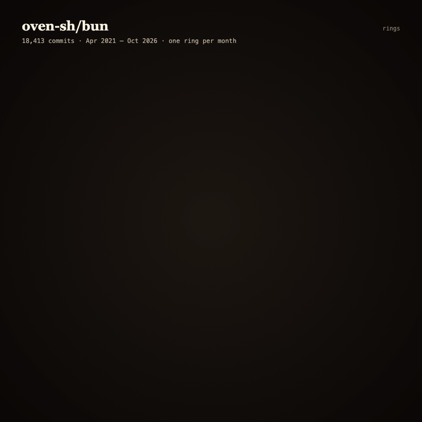

<p align="center">
  
</p>

<h1 align="center">Rings</h1>

<p align="center"><b>Tree rings for your codebase: see when AI moved in.</b><br>
One ring per month since the first commit. Colour wherever the history itself discloses an AI co-author, an AI agent's own account, or a bot account.</p>

<p align="center">
  <a href="https://vnmoorthy.github.io/rings/"><b>Gallery of famous repos</b></a> ·
  <a href="#install">Install</a> ·
  <a href="#how-it-reads-history">How it reads history</a> ·
  <a href="#中文">中文</a>
</p>

```bash
npx skills add vnmoorthy/rings -g      # then, in Claude Code or Codex: /rings
```

```bash
npx github:vnmoorthy/rings oven-sh/bun # or any owner/name, URL, or local path
```

No API keys, no dependencies (Node built-ins only), nothing uploaded. Remote repos are cloned history-only, so even large ones take seconds.

## What it shows

Rings cuts a repository open like a log. The pith is the first commit, the bark is today. Each ring is one month (one week, day or commit for younger repos) and its width comes from that month's commit count. Coloured arcs inside a ring show the share of that month's commits that carry a signal:

| | Signal | Example |
|---|---|---|
| 🟧 | **AI co-author trailer** | `Co-authored-by: Claude <noreply@anthropic.com>`, Codex, Copilot, Cursor, Gemini, Aider, opencode, Amp ... |
| 🟪 | **AI agent account** | the author is `copilot-swe-agent[bot]`, `devin-ai-integration[bot]`, `google-labs-jules[bot]`, `claude[bot]` ... |
| 🟩 | **Bot-named account** | `dependabot[bot]`, `github-actions[bot]`, `*bot`, `robo*` ... |
| 🟢 | **During an agent session** (your own repo, opt-in) | made while a local Claude Code or Codex session was running in that repo |
| 🪵 | **No AI signal** | not the same as "written by a human" |

Hover a ring for its counts, agents, accounts and a sample commit hash. Export a 1080×1080 PNG or a 1200×630 social card from the page.

## From the gallery

Numbers from each project's public history (non-merge commits on the default branch), read on 14 Oct 2026:

- **oven-sh/bun**: Claude co-author trailers rose to 61% of commits in Feb 2026. From Apr 2026 they are near zero, and one account, `robobun`, authored up to 87% of a month's commits while monthly volume rose from 175 to 1,042.
- **denoland/deno**: trailers peaked at 61% in Mar 2026.
- **astral-sh/uv**: 25% at the Jan 2026 peak. **openai/codex**: Codex co-author trailers in up to 20% of a week's commits.

Disclosure is not usage. Trailers change with tool defaults, squash merges and agents that commit under their own accounts. Rings shows what the history says and nothing more. **[See all repos →](https://vnmoorthy.github.io/rings/)**

## Install

As an [Agent Skill](https://agentskills.io) (a folder with a `SKILL.md`; this repository is that folder):

| Agent | Command |
|---|---|
| Claude Code | `npx skills add vnmoorthy/rings -g -a claude-code` |
| Codex | `npx skills add vnmoorthy/rings -g -a codex` |
| OpenCode | `npx skills add vnmoorthy/rings -g -a opencode` |
| anything else | `git clone https://github.com/vnmoorthy/rings` and point your agent at `SKILL.md` |

Then ask: *"ring this repo"*, *"draw tree rings for vercel/next.js"*, or `/rings`.

As a plain CLI:

```bash
npx github:vnmoorthy/rings [repo] [options]

  repo              local path (default .), owner/name, or a GitHub URL
  -o, --out <file>  HTML to write (default ./<owner>-<name>-rings.html)
  --sessions        your own repo: mark commits made during local Claude Code / Codex sessions
  --unit <u>        auto | month | quarter | week | day | commit
  --bots a,b        extra automation accounts      --humans a,b   never count these as bots
  --ref <ref>       branch to read                 --json         machine-readable summary
  --open            open the page when done
```

## How it reads history

- `git log --no-merges` on the default branch, author dates in UTC. Only commit metadata is read; remote repos are cloned with `--filter=tree:0` into `~/.cache/rings`.
- **Trailers** are matched on an agent's own display name or no-reply address. Company domains are never enough (Bun's engineers commit from anthropic.com, OpenAI's from openai.com), and a human co-author called Claude, Devin or Jules is never counted. The rules and their tests are in [`lib/classify.mjs`](lib/classify.mjs) and [`test/`](test/).
- **Ring size** adapts to age: monthly for repos older than two years, weekly from three months, daily from a week, one ring per commit below that. Width is the square root of the commit count, capped at 2.5× the median so one burst cannot flatten the rest; empty months leave a thin dark line.
- **`--sessions`** reads only the first and last few KB of each transcript in `~/.claude/projects` and `~/.codex/sessions` (working directory and timestamps). It never leaves your machine, and transcripts your tools have already cleaned up simply aren't there.

Maintainers: if you'd like your repo out of the gallery or a bot list corrected, [open an issue](https://github.com/vnmoorthy/rings/issues).

## Prior art

[Gource](https://gource.io) animates repository history as a tree of files. [git-of-theseus](https://github.com/erikbern/git-of-theseus) charts how much code from each year survives. [git-ai](https://github.com/git-ai-project/git-ai) tracks AI authorship line by line as you work. Rings is a single still picture of a repo's whole life, built only from what its commits already disclose.

## 中文

**Rings：把代码仓库像树干一样切开，看 AI 是什么时候“长”进来的。** 从第一次提交开始，每个月一圈年轮，宽度由当月提交数决定；如果提交记录本身标注了 AI 合著者（如 `Co-authored-by: Claude`）、AI 代理账号（如 `copilot-swe-agent[bot]`）或机器人账号，就在年轮上着色。没有颜色只代表“没有信号”，不等于“人写的”。

```bash
npx skills add vnmoorthy/rings -g     # 然后在 Claude Code / Codex 里输入 /rings
npx github:vnmoorthy/rings oven-sh/bun
```

无需 API key，零依赖，不上传任何数据。[查看知名仓库的年轮 →](https://vnmoorthy.github.io/rings/)

## License

MIT
